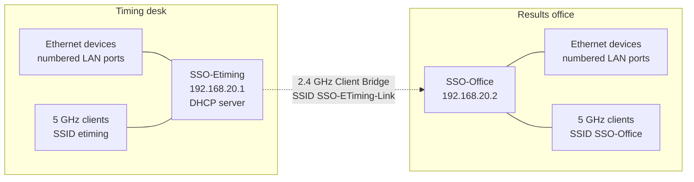

# E-Timing wireless LAN setup

## Purpose

Connect the timing desk and results office at a speed skating meet without an Ethernet cable between the two locations. Computers connected by Ethernet at either location, and a small number of Wi-Fi clients, share one LAN and can access the timing computers' file shares and software.

This guide describes the configuration for two ASUS RT-AC68U routers running **DD-WRT v3.0-r30709**, starting from factory-default DD-WRT settings. It documents the intended settings and the checks that confirm a rebuilt installation works.

The LAN has no Internet connection. Computers may use venue Wi-Fi, or a phone hotspot where venue Wi-Fi is unusable, for Internet access. See [Venue notes]({{ '/venue-notes.html' | relative_url }}) for rink-specific network behavior.

## Network design

| Setting | Timing desk | Results office |
| --- | --- | --- |
| Router name | `SSO-Etiming` | `SSO-Office` |
| Router LAN address | `192.168.20.1` | `192.168.20.2` |
| Subnet mask | `255.255.255.0` | `255.255.255.0` |
| DHCP server | Enabled | Disabled |
| 2.4 GHz radio mode | AP | Client Bridge |
| 2.4 GHz SSID | `SSO-ETiming-Link` | Joins `SSO-ETiming-Link` |
| 5 GHz radio mode | AP | AP |
| 5 GHz client SSID | `etiming` | `SSO-Office` |
| Ethernet devices | Numbered LAN ports | Numbered LAN ports |
| WAN port | Unused | Unused |

The **2.4 GHz radio is the backhaul**. `SSO-Etiming` advertises `SSO-ETiming-Link`, and `SSO-Office` joins that SSID in Client Bridge mode. Its 20 MHz channel width prioritizes a usable link over maximum throughput. Expected separation is approximately 50–200 feet, depending on the venue; actual reliability must be tested at each rink. Computers and phones do not join `SSO-ETiming-Link`.

The **5 GHz radios provide local Wi-Fi access**. Timing-desk clients join `etiming`. Office clients join `SSO-Office`, so those devices must support 5 GHz.

**SSID convention:** `SSO-ETiming-Link` is only the router-to-router bridge. `etiming` is the timing desk's client SSID. `SSO-Office` is the office's client SSID. The office's 2.4 GHz Client Bridge must specify `SSO-ETiming-Link`, because that field identifies the network it joins; it does not advertise an office Wi-Fi network.

All interfaces remain on the default LAN bridge, `br0`. There are no guest networks, separate office subnet, or additional DHCP servers.



Solid lines are Ethernet or local Wi-Fi on that router. The dotted line is the wireless bridge. WAN ports stay unused, and the routers are not also joined by an Ethernet cable.

## Address plan and credentials

| Purpose | Address |
| --- | --- |
| Network | `192.168.20.0/24` |
| Timing router | `192.168.20.1` |
| Office router | `192.168.20.2` |
| Temporary configuration computer | `192.168.20.10` |
| Fixed-address equipment | Unused addresses from `192.168.20.11` through `192.168.20.127` |
| DHCP pool | `192.168.20.128` through `192.168.20.199` |

Assign stable addresses to computers hosting shares or services, either manually outside the DHCP pool or using DHCP reservations on `SSO-Etiming`. Record those assignments separately. Addresses in this document such as `192.168.20.25` are examples, not confirmed equipment assignments.

Equipment still using static `192.168.0.x` addresses must be moved to `192.168.20.x` before it can share this LAN. The [setup diagram]({{ '/etiming-setup-diagram.html' | relative_url }}) and [MYLAPS clock synchronization]({{ '/mylaps-capture-ntp.html' | relative_url }}) still record hosts on `192.168.0.x`, including Capture at `192.168.0.25`. Check applications, mapped drives, decoder settings, and any other configuration that refers to an old address. Avoid duplicate addresses.

Obtain the following from the timing team's secure credential record:

- Administrative credentials for each router.
- The `SSO-ETiming-Link` wireless password, used only by the backhaul.
- The `etiming` wireless password, used by timing-desk Wi-Fi clients.
- The `SSO-Office` wireless password, which may be the same as the `etiming` password.
- Credentials for any Windows shares or applications.

Do not put passwords in this document or in the Git repository.

## 1. Prepare the routers

1. Put the routers a few metres apart for initial setup.
2. Start with factory-default **DD-WRT** settings. Resetting DD-WRT does not restore ASUS firmware. If a router is already configured for a live meet, save its configuration before resetting it.
3. Configure one router at a time using a computer connected to a numbered **LAN** port. Leave the WAN ports unused.
4. Temporarily disable the configuration computer's Wi-Fi so the Ethernet connection is unambiguous.
5. A reset router normally answers at `http://192.168.1.1`. Set its administrative credentials when prompted.

Do not connect an Ethernet cable between the routers once the wireless bridge is operating. An additional LAN connection can create a network loop.

In DD-WRT, **Save** stages changes and **Apply Settings** activates them. Applying wireless or LAN changes can briefly disconnect the browser.

## 2. Configure SSO-Etiming

### LAN and DHCP

Open `http://192.168.1.1`, or `http://192.168.20.1` if its LAN address has already been changed.

Under **Setup → Basic Setup**, enter:

| Setting | Value |
| --- | --- |
| WAN Connection Type | Disabled |
| Router Name | `SSO-Etiming` |
| Local IP Address | `192.168.20.1` |
| Subnet Mask | `255.255.255.0` |
| Gateway | `0.0.0.0` |
| Local DNS | `0.0.0.0` |
| DHCP Type, if shown | DHCP Server |
| DHCP Server | Enable |
| Start IP Address | `192.168.20.128` |
| Maximum DHCP Users | `72` |

If the Start IP field only accepts the last octet, enter `128`. Save and apply. The pool is `192.168.20.128` through `192.168.20.199`.

After changing the router address, reconnect the computer's Ethernet connection to renew its address, then open `http://192.168.20.1`. If necessary, temporarily use the manual computer address described in section 3.

### Wireless basic settings

Under **Wireless → Basic Settings**, configure both physical interfaces:

| Setting | 2.4 GHz | 5 GHz |
| --- | --- | --- |
| Wireless Mode | AP | AP |
| Wireless Network Mode | NG-Mixed if offered; otherwise Mixed | Mixed with N/AC support |
| Wireless Network Name (SSID) | `SSO-ETiming-Link` | `etiming` |
| Wireless Channel | 6 initially | 36 |
| Channel Width | 20 MHz | 20 MHz |
| Wireless SSID Broadcast | Enable | Enable |
| Network Configuration, if shown | Bridged | Bridged |

On this model, `wl0` is normally 2.4 GHz and `wl1` is normally 5 GHz. Confirm using the available channels rather than relying only on the interface name: channels 1–11 are 2.4 GHz; channels such as 36 and 48 are 5 GHz.

### Wireless security

Under **Wireless → Wireless Security**, configure:

| Setting | 2.4 GHz — backhaul | 5 GHz — timing-desk clients |
| --- | --- | --- |
| Security Mode | WPA2 Personal | WPA2 Personal |
| WPA Algorithms | AES only | AES only |
| WPA Shared Key | The recorded `SSO-ETiming-Link` password | The recorded `etiming` password |
| Key Renewal Interval | Default | Default |

Do not select TKIP or TKIP+AES. The two radios advertise different SSIDs, so their passwords are independent.

Under **Wireless → Advanced Settings**, leave **AP Isolation** disabled for both radios. Leave transmit power and other advanced settings at defaults.

Save and apply.

## 3. Configure SSO-Office

Connect the configuration computer to a LAN port on the reset office router and open `http://192.168.1.1`.

### LAN settings

Under **Setup → Basic Setup**, enter:

| Setting | Value |
| --- | --- |
| WAN Connection Type | Disabled |
| Router Name | `SSO-Office` |
| Local IP Address | `192.168.20.2` |
| Subnet Mask | `255.255.255.0` |
| Gateway | `192.168.20.1` |
| Local DNS | `0.0.0.0` |
| DHCP Server | Disable |

Save and apply. Losing browser access now is expected: the router changed subnets and stopped supplying DHCP addresses.

Temporarily set the computer's Ethernet IPv4 configuration to:

| Setting | Value |
| --- | --- |
| IP address | `192.168.20.10` |
| Subnet mask | `255.255.255.0` |
| Default gateway | Blank |
| DNS servers | Blank |

On Windows 11, open the Ethernet adapter's properties and edit **Internet Protocol Version 4 (TCP/IPv4)**. One route is **Win+R → `ncpa.cpl` → Ethernet → Properties**.

Open `http://192.168.20.2` to continue.

### Wireless basic settings

Under **Wireless → Basic Settings**, configure:

| Setting | 2.4 GHz — bridge | 5 GHz — office clients |
| --- | --- | --- |
| Wireless Mode | **Client Bridge** | **AP** |
| Wireless Network Mode | Match SSO-Etiming's 2.4 GHz setting | Mixed with N/AC support |
| Wireless Network Name (SSID) | **`SSO-ETiming-Link`** | **`SSO-Office`** |
| Wireless Channel | Follows SSO-Etiming | 48 |
| Channel Width | 20 MHz, if shown | 20 MHz |
| Wireless SSID Broadcast | Not applicable to the client connection | Enable |
| Network Configuration, if shown | Bridged | Bridged |

Select **Client Bridge**, not plain **Client**. The 2.4 GHz channel selector may disappear in Client Bridge mode. No virtual wireless interface or Repeater Bridge mode is needed: the separate 5 GHz radio serves office clients.

### Wireless security

Under **Wireless → Wireless Security**, configure:

| Setting | 2.4 GHz — bridge | 5 GHz — office clients |
| --- | --- | --- |
| Security Mode | WPA2 Personal | WPA2 Personal |
| WPA Algorithms | AES only | AES only |
| WPA Shared Key | Exactly the `SSO-ETiming-Link` password on SSO-Etiming | Recorded `SSO-Office` password |
| Key Renewal Interval | Default | Default |

`SSO-ETiming-Link` spelling and capitalization, security mode, encryption algorithm, and bridge password must match the timing router.

Under **Wireless → Advanced Settings**, leave **AP Isolation** disabled on both radios. Keep other advanced settings at defaults.

### Routing and firewall

1. Under **Setup → Advanced Routing**, set **Operating Mode → Router** and save.
2. Under **Security → Firewall**, set **SPI Firewall → Disable** and save.
3. Apply settings and reboot SSO-Office.
4. Allow a couple of minutes for the wireless connection to establish.

Keep both radios on the default LAN bridge, `br0`. Do not create a separate office subnet. **SSO-Etiming must be the only DHCP server.**

## 4. Verify the rebuilt network

### Router-to-router link

With the computer still plugged into SSO-Office and using temporary address `192.168.20.10`, run:

```bat
ping 192.168.20.2
ping 192.168.20.1
```

Both should respond. The first checks local access to the office router. The second checks the wireless path to the timing router.

### DHCP through the bridge

Return the computer's Ethernet IPv4 settings to **Obtain an IP address automatically** and **Obtain DNS server address automatically**. Reconnect Ethernet, then run:

```bat
ipconfig /all
```

The Ethernet adapter should have an address in `192.168.20.128`–`192.168.20.199`, mask `255.255.255.0`, and DHCP server `192.168.20.1`. An address beginning `169.254` means it did not obtain a DHCP lease.

### File shares and applications

Connect a host computer to SSO-Etiming and give it a stable LAN address. From an office computer, test its share by IP in File Explorer, for example:

```text
\\192.168.20.25\Results
```

Replace both the address and share name with the real values. Accessing a share directly is a better initial test than waiting for it to appear under Windows Network.

For software accessed in a browser, use its actual LAN address and port, for example `http://192.168.20.25:8080`. The application must listen on the LAN interface, not only `localhost`.

On Windows hosts, use a **Private** network profile for this LAN and allow File and Printer Sharing and the required applications through Windows Firewall on Private networks. Use valid share credentials. Do not disable Windows Firewall as a general fix.

### Wi-Fi clients

1. Join `SSO-Office` near the office router.
2. Confirm a `192.168.20.x` address is assigned.
3. Open `http://192.168.20.1` and access the required timing-desk application or share.
4. Repeat using `etiming` near the timing desk. Leave `SSO-ETiming-Link` for the routers.
5. Test multiple office computers and at least one Wi-Fi client at the same time.

The network intentionally has no Internet. On phones or tablets, accept any prompt to remain connected despite the lack of Internet.

### Restart recovery

Restart each router separately, then restart both together. Confirm the bridge reconnects, DHCP works, and shares and applications become accessible again. Test a computer starting after the routers and a computer already running while the bridge reconnects.

## 5. Deploy at a rink

- Place the routers above desk height and, where practical, above people.
- Keep antennas generally upright and seek a clear path between locations.
- Avoid metal cabinets, structural metal, and placing routers on the floor.
- Leave the 2.4 GHz channel width at 20 MHz.
- Start on channel 6. If necessary, test channels **1, 6, and 11** and choose the one with the most reliable connection. Change the channel on SSO-Etiming; SSO-Office follows it.
- Check **Status → Wireless** for connection information, signal, and noise. Packet loss and usable file transfers matter more than displayed signal bars.

From an office computer, run a continuous ping to the share host while transferring files:

```bat
ping -t 192.168.20.25
```

Use the actual host address. Stop with **Ctrl+C** to see the packet-loss summary. Repeated timeouts or frequent large latency spikes call for a placement or channel change. Verify at the real office location before racing begins. A successful same-room test does not establish range.

## 6. Separate Internet access on computers

A computer may use Ethernet for this timing LAN and venue Wi-Fi for Internet, provided the subnets do not overlap. Do not enable Windows Internet Connection Sharing or bridge the computer's adapters.

DD-WRT may advertise itself as a default gateway or DNS server through DHCP even though this LAN has no Internet. If that interferes with venue Wi-Fi Internet access, configure DHCP on SSO-Etiming to omit those options, or configure that computer's timing-LAN Ethernet connection with a fixed address and **blank gateway and DNS**. The router's own Gateway field being `0.0.0.0` does not by itself guarantee DHCP clients receive no default gateway.

The local `192.168.20.x` route is sufficient to reach timing equipment. If venue Wi-Fi also uses `192.168.20.0/24`, the overlap must be resolved. Changing interface priority alone is not a reliable solution.

## Troubleshooting

| Symptom | Checks |
| --- | --- |
| Cannot reach SSO-Office locally | Use a LAN port, check the computer's address and mask, and try temporary address `.10`. |
| Can reach `.2` but not `.1` | Check the office 2.4 GHz mode, SSID `SSO-ETiming-Link`, WPA2/AES/password match, and timing-router radio. Inspect Status → Wireless. |
| Static address works but DHCP does not | Check that DHCP is enabled only on SSO-Etiming and interfaces remain bridged. Reconnect the client and test again. |
| Office Wi-Fi does not appear | Confirm the 5 GHz radio is enabled in AP mode with SSID broadcast enabled. Check that the device supports 5 GHz. |
| Wi-Fi joins but cannot reach LAN hosts | Check AP Isolation, bridge membership, DHCP address, and host firewall. |
| Routers respond but share or application fails | Test by IP. Check host address, application listening interface, firewall, credentials, and share permissions. |
| Devices still use `192.168.0.x` | Update static addresses and references in applications and mapped drives. |
| Link works nearby but fails at the rink | Improve placement, reduce obstructions, test channels 1/6/11, and check packet loss under actual conditions. |
| One client works but multiple clients fail | Investigate Client Bridge limitations. One successful ping is not proof of a working deployment. |

## Backups and firmware

After verification, use **Administration → Backup** on each router and label the files with router name, firmware build, and date. Keep credentials and backups in the team's restricted records. Retain this guide alongside an inventory of fixed addresses and share names.

Client Bridge is not a fully transparent Ethernet bridge. Test the actual IPv4 file-sharing and application workload with all expected clients, including restart recovery.

The documented firmware is from 2016. A newer, model-compatible DD-WRT build may provide security and bug fixes, but it can also change menus or bridge behavior. Treat upgrading as a separate planned change: check the hardware revision and build compatibility, use a wired connection, configure clean settings manually, and repeat all verification. Do not assume an old settings backup is suitable for a much newer build, and do not upgrade immediately before a meet without time to test.
