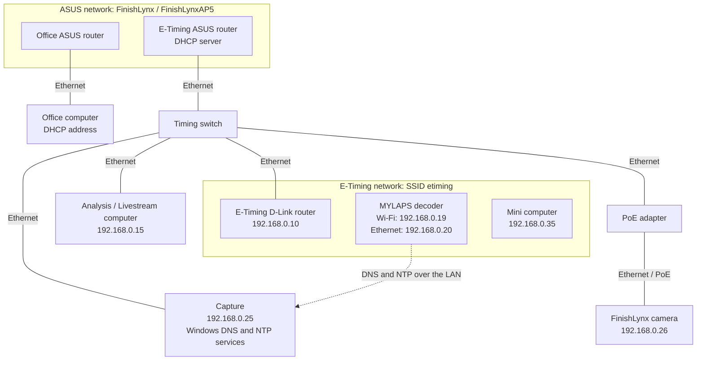
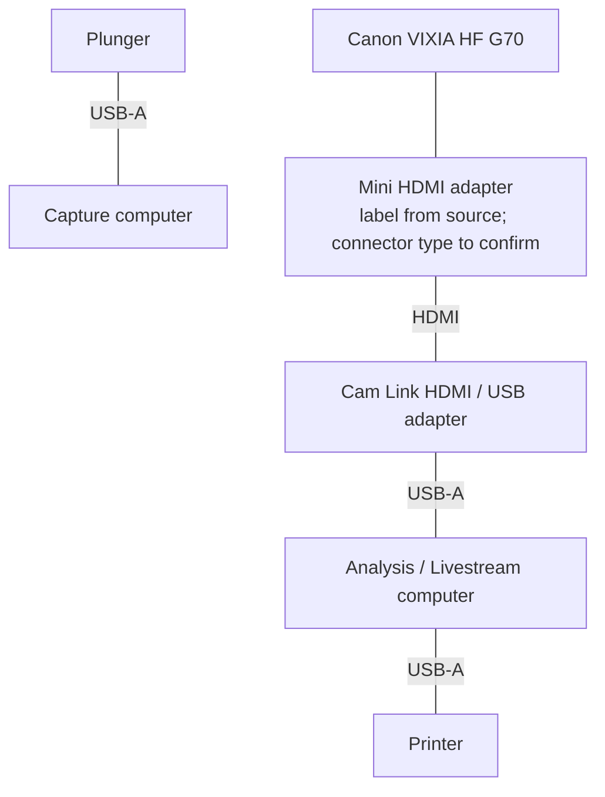
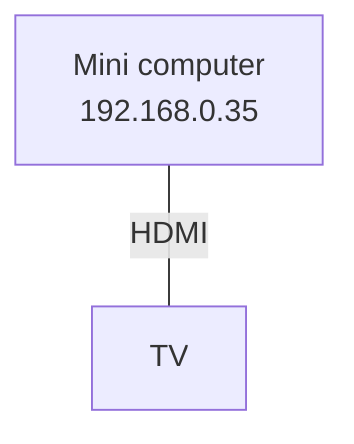

# SSO FinishLynx E-Timing Setup

This is an editable transcription of the supplied setup diagram, with the confirmed Capture DNS/NTP addition. The source image describes an older setup: inventory and links below still need comparison with the equipment currently deployed. No passwords or actual account usernames are included.

Edit the Mermaid code blocks to update the diagrams. Stable identifiers such as `capture` identify devices in the source; their quoted labels supply the displayed names. Solid lines represent physical cables, not packet direction. Dotted lines represent logical communication or a relationship whose physical path is unspecified.

## Network and timing equipment

The diagram groups equipment by the clouds in the source image. Grouping does not establish separate IP subnets or VLANs. The source image does not draw the physical connection between the ASUS routers or the decoder/mini-computer connections within the E-Timing cloud. Those links are deliberately not invented here. The decoder can use Wi-Fi or Ethernet; the dotted DNS/NTP arrow does not imply a direct cable to Capture.

### Items to confirm

- The [wireless LAN setup]({{ '/etiming-router-setup.html' | relative_url }}) links these ASUS routers with a 2.4 GHz client bridge on `192.168.20.0/24`. This diagram is still the older source image: it does not show that bridge, and its equipment addresses are `192.168.0.x`.
- Whether the D-Link unit operates as a router or an access point, and whether its DHCP server is disabled.
- How the mini computer attaches to the LAN.
- Which connection gives Capture internet access. It is separate from the isolated timing LAN; the source image does not show its physical path.
- Whether all listed equipment addresses and SSIDs are still current.

## Peripherals and video

These diagrams separate peripheral cabling from network cabling.

The source labels the camera-side component “Mini HDMI Adapter.” Confirm the actual connector before purchasing replacements; this transcription is not a connector compatibility specification. The start-gun signal path is not shown in the source and should be added after its current wiring is confirmed.

## Equipment inventory

Credential references below are proposed password-manager item names, not existing vault entries or secret values.

| Device / service | Address or identifier | Notes | Proposed credential reference |
| --- | --- | --- | --- |
| Capture | `192.168.0.25` | Timing computer; Windows Time server and Technitium DNS | `SSO / Capture / Windows login` |
| Analysis / Livestream | `192.168.0.15` | Printer and video capture attached | `SSO / Analysis / Windows login` |
| MYLAPS decoder | Wi-Fi `.19`; Ethernet `.20` on `192.168.0.x` | Two possible interface addresses; do not assume simultaneous use | Add a decoder item only if credentials are required |
| FinishLynx camera | `192.168.0.26` | Source notes camera address as Capture IP + 1; recheck after address changes | Not specified |
| D-Link router | `192.168.0.10` | Operating mode to confirm | `SSO / D-Link / Administrator` |
| E-Timing Wi-Fi | SSID `etiming` | Password stored separately | `SSO / E-Timing Wi-Fi` |
| Mini computer | `192.168.0.35` | HDMI output to TV | `SSO / Mini computer / Windows login` |
| E-Timing ASUS router | Address not specified | Source identifies it as DHCP server | `SSO / E-Timing ASUS / Administrator` |
| Office ASUS router | Address not specified | Inter-router connection to confirm | `SSO / Office ASUS / Administrator` |
| ASUS Wi-Fi | `FinishLynx`, `FinishLynxAP5` | SSID-to-radio/router mapping not specified | `SSO / FinishLynx Wi-Fi` |
| Office computer | DHCP | Ethernet to office ASUS router | Not specified |
| Technitium | Capture, TCP 5380 administration | Local console: `http://localhost:5380/` | `SSO / Capture / Technitium administrator` |

## Current DNS and NTP addition

The original diagram predates this configuration:

- The decoder uses `192.168.0.25` as its DNS server.
- Technitium on Capture answers `us.pool.ntp.org` with `192.168.0.25`.
- Windows Time serves Capture's clock over UDP port 123.
- Capture obtains upstream time from `time.windows.com` using its internet connection.
- Windows Firewall permits decoder DNS and NTP requests from both `192.168.0.19` and `192.168.0.20`.
- Capture retains its normal DNS settings; it does not need to use Technitium for its own lookups.

See [MYLAPS clock synchronization through Capture]({{ '/mylaps-capture-ntp.html' | relative_url }}) for setup and verification instructions. This synchronizes the decoder with Capture, not automatically with the FinishLynx camera or other timing equipment.

## Keeping diagrams maintainable

Start by maintaining these Mermaid blocks and the inventory together. Changes produce readable Git diffs and can be reviewed in pull requests. Mermaid is sufficient for this size of setup; a separate YAML inventory plus a diagram generator becomes useful if multiple diagrams must reuse the same equipment data.

GitHub renders Mermaid code blocks in repository Markdown views. A GitHub Pages site requires its theme or layout to load and render Mermaid; Pages does not automatically inherit GitHub's repository viewer. Without that support, the Mermaid blocks appear as source text. For reliable publishing with an existing Pages theme, either add Mermaid support to the layout or render the diagrams to SVG during the build and embed the SVG files. Keep the text source authoritative.

## Sharing operator credentials

Use an organization-owned password manager with individual operator accounts. Keep actual usernames, passwords, recovery codes, and secret-bearing sharing links out of this page and out of the Git repository. Documentation can reference the proposed item names above.

A useful structure is two shared collections or vaults:

- **E-Timing Operators:** Wi-Fi access and the device logins needed during meets.
- **E-Timing Administrators:** router administration, Technitium administration, and recovery information, available to the people maintaining the setup.

Keep at least two authorized maintainers able to administer the shared credentials, enable MFA on their individual accounts, and document recovery ownership. Operators should sign in and sync their vault before travelling to a venue, then test that the needed items remain accessible with internet disconnected and the vault locked and unlocked. Offline access depends on the chosen app and policy; do not rely on opening a new web session at the rink.

Removing someone from the shared vault prevents future authorized access but cannot erase credentials they already learned or copied. Rotate relevant shared device passwords when access must actually be revoked, and update the vault items together with the affected devices.

The supplied source image still contains a visible Wi-Fi password even though other credentials are redacted. This text deliberately omits it. Before publishing any version of the image, remove it; if it has already been distributed beyond the intended operators, rotate that password. If a secret enters Git history, deleting it from the current page is not sufficient: rotate the secret and address the historical copies separately.

### Candidate tools

- [Bitwarden organizations](https://bitwarden.com/help/getting-started-organizations/) provide shared credentials through collections. Its free organization supports two users; a larger operator group needs an appropriate organization plan.
- [1Password shared vaults](https://support.1password.com/create-share-vaults-teams/) provide access by team member or group; [guest access](https://support.1password.com/guests-teams/) can fit occasional operators needing one vault.

If SSO already maintains an organizational password manager, use it rather than creating a parallel credential store. Otherwise, choose between these based on operator count, existing accounts, administration needs, and offline access requirements. Plan a small pilot with two operators before migrating all credentials.
