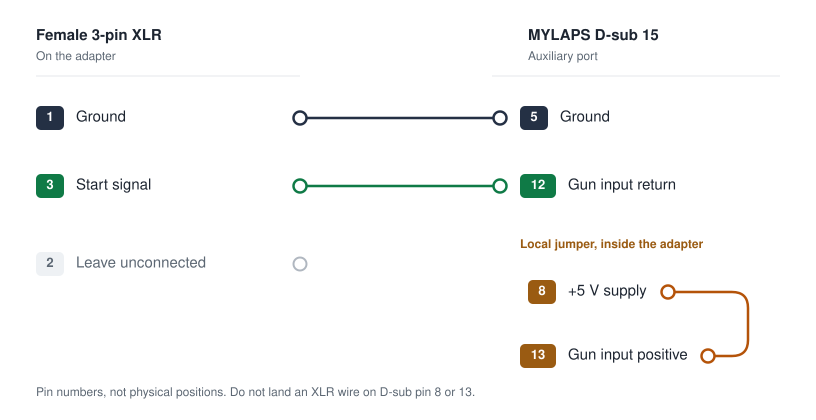

# Starter timing cable: XLR to MYLAPS D-sub 15

This adapter connects the three-pin XLR timing branch of the starter pistol’s breakout cable to the MYLAPS ProChip Smart Decoder’s two-row D-sub 15 auxiliary port. The breakout cable plugs into the pistol’s four-pin XLR output and separates it into a three-pin XLR timing connection and a 3.5 mm audio plug for the speaker.

## Wiring diagram

The diagram shows electrical connections by pin number, rather than physical pin positions. The XLR connector on the adapter is **three-pin female**. The dark lead is ground, matching the black ENCRADIO banana. The green lead is the start signal, matching the green banana. The amber link is the jumper inside the D-sub shell.

The table below lists the same connections.

## Connection table

| Connection | Destination | ENCRADIO equivalent |
| --- | --- | --- |
| XLR pin **1** | D-sub pin **5** | **Black** banana: ground |
| XLR pin **3** | D-sub pin **12** | **Green** banana: start signal |
| D-sub pin **8** | D-sub pin **13**, through a short local jumper | Not connected to the ENCRADIO |
| XLR pin **2** | Leave unconnected | Unused by the green/black banana adapter |

Leave all other D-sub pins unconnected for this adapter. Do not connect either XLR signal wire directly to D-sub pin 8 or 13.

## Why pins 8 and 13 are joined

The decoder senses a start through an optocoupler. The **8-to-13 jumper** feeds its positive input from the decoder's own +5 V supply. When the pistol briefly connects XLR pins 3 and 1, it connects D-sub pin 12 to ground through pin 5, completing the sensing circuit:

**Pin 8 (+5 V) → jumper → pin 13 → internal sensing circuit → pin 12 → pistol's closed timing switch → pin 5 (ground).**

The jumper stays inside the D-sub adapter. This is the decoder's **potential-free contact** wiring arrangement. A receiver that supplies an active voltage pulse requires a different arrangement; do not apply that pulse using this wiring without checking its specifications.

## Assembly and verification

1. Disconnect the adapter from all equipment before wiring or continuity testing.
2. Follow the pin numbers moulded or stamped into each connector. Mating-face and solder-side views are mirrored; do not identify pins by left/right position alone.
3. Check continuity for **XLR 1 ↔ D-sub 5**, **XLR 3 ↔ D-sub 12**, and **D-sub 8 ↔ 13**. Confirm these three separate groups are not shorted together, and XLR pin 2 is unconnected.
4. Connect the adapter and test a start. If sharing the pistol's timing output through the tested passive XLR splitter, confirm that both MYLAPS and the ENCRADIO/photo-finish system receive exactly one event per shot.
5. Repeat with the full cable length and each starting location that will be used at the meet.

## Validation recorded for this setup

- ENCRADIO idle signal voltage, green relative to black: approximately **+4.04 V DC**.
- MYLAPS idle signal voltage, pin 12 relative to pin 5 with the 8-to-13 jumper fitted: approximately **+4.01 V DC**.
- The pistol, one ENCRADIO, and MYLAPS were connected through a passive timing splitter, and all expected starts were received by both systems.

These observations document this tested configuration; they do not establish compatibility for arbitrary additional receivers or inputs.
